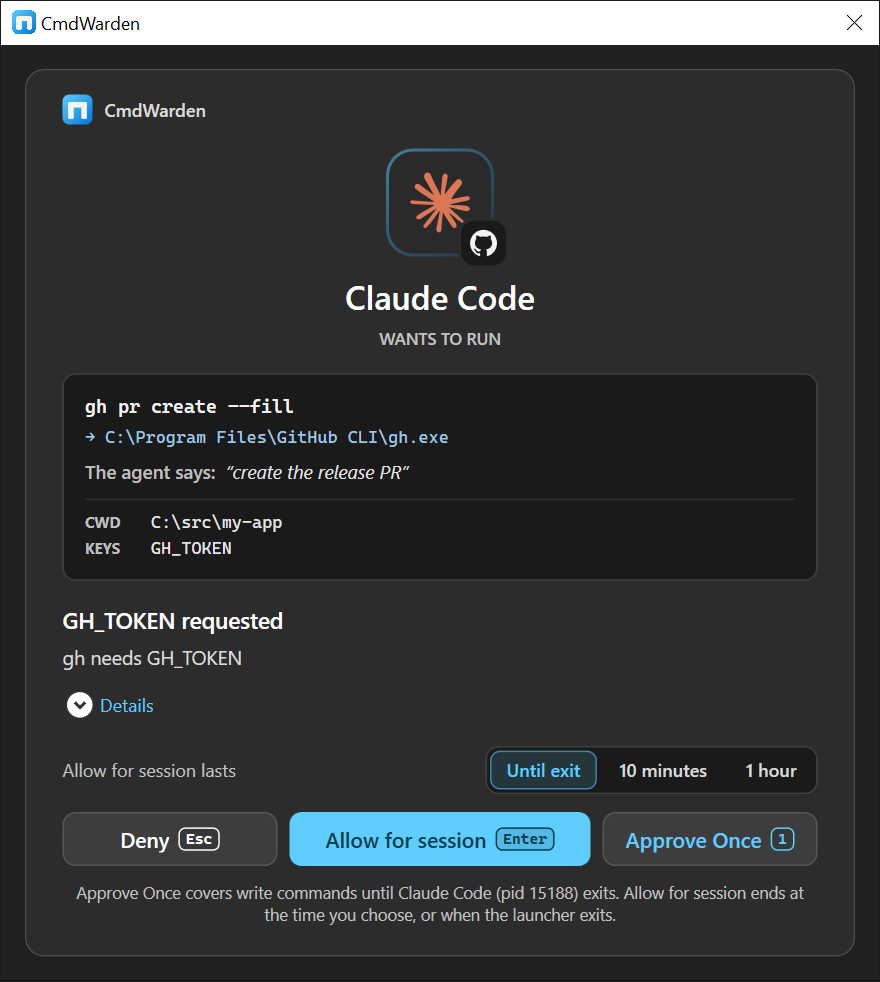
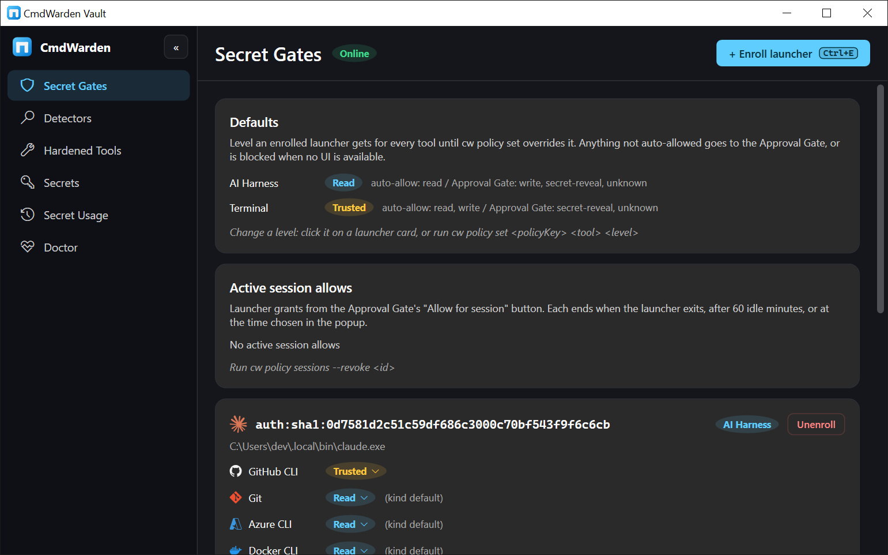
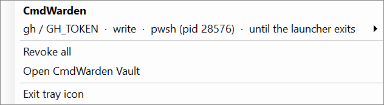

# Command walkthrough

Use this page on a Windows PC. You install CmdWarden. You run each command. You look at the screen.

Run the setup commands in your own terminal. A harness is the test target, not the place you set up from.

Three surfaces exist:

| Surface | How you open it | What you check |
|---------|-----------------|----------------|
| CLI | Type `cw` in a terminal | Text and the exit code |
| Approval Gate | A gated command opens the card | Deny, Allow for session, Approve Once |
| CmdWarden Vault | Start Menu or the tray icon | The same data as the CLI, with no secret value |

The CLI name is `cw`. The alias is `cmdwarden`. Both names run the same commands.

---

## 1. Install

You need Windows 10 or 11 and a desktop session. The card needs that session. You need about 250 MB of disk.

The install does not change `gh` or `git`. Those tools stay as they are until `cw setup` or `cw harden`.

### Setup zip

1. Download `CmdWarden.<version>-setup.zip` from the [latest release](https://github.com/BasantPandey/CmdWarden/releases/latest).
2. Extract the zip.
3. Double-click `install.cmd`. Run it as your user.
4. The installer copies the app to `%LOCALAPPDATA%\CmdWarden\app`.
5. It adds `cw` to your user PATH.
6. It adds **CmdWarden** under Settings > Apps.
7. Open a new terminal.

You see `cw` on PATH. `cw version` prints the product version.

### Portable zip

1. Extract `CmdWarden.<version>-win-x64.zip`.
2. In that folder, run `.\cw.exe setup`.

### winget

The catalog has BasantPandey.CmdWarden version 0.10.0. The commands are `cw` and `cmdwarden`.

```powershell
winget source update
winget install BasantPandey.CmdWarden
```

Open a new terminal. Run `cw version`. You see 0.10.0. The setup zip above stays available. See [Install](install.md).

### NuGet.org

NuGet.org has package CmdWarden 0.12.0: https://www.nuget.org/packages/CmdWarden/0.12.0.

You need the .NET 10 SDK. Run:

```powershell
dotnet tool install -g CmdWarden
```

Open a new terminal. Run `cw setup`. The gallery form is `dotnet tool install --global CmdWarden --version 0.12.0`.

---

## 2. Set up

In your own terminal, run:

```powershell
cw setup
```

Each step asks first. Press Enter for yes. `cw setup --yes` runs every step with no question.

| Step | What you accept | What you see when it is done |
|------|-----------------|------------------------------|
| terminal | Enroll this terminal as Trusted | Your own shell gets no card for normal work |
| tools | Harden each tool that is installed | `gh`, `git`, `az`, `docker`, `npm`, `aws`, `kubectl`, and `ssh` when they exist |
| harnesses | Enroll each harness at Read | Hook, leak guard, and MCP server for Claude Code, Cursor, Codex, and Grok |
| shortcuts | Start Menu, tray, Settings > Apps | **CmdWarden Vault** in the Start Menu |
| canary | Plant fake tokens | A use of one shows an alarm and blocks that app |
| protect | Turn on harness protections | Claude Code and Codex only. Grok has no `cw protect` step |
| try | Show the real card | A stand-in agent asks for the fake secret `CW_TRY_TOKEN` |

A step that is already done says so. Run `cw setup` again at any time.

Leave a step out with `--skip`. Example: `cw setup --skip canary,try`.

Then restart each harness. Open a new terminal. They must read the new PATH and the new hooks.

Check the install:

```powershell
cw version
cw doctor
cw whoami
cw policy list
cw harden --list
```

You see these results:

- `cw doctor` says the Session Agent is up. It starts the agent when the agent is down.
- `cw whoami` names this terminal and its policy key.
- `cw policy list` shows this terminal as Trusted.
- `cw policy list` shows each harness as an AI harness at Read.
- `cw harden --list` shows **Hardened** for each tool that setup found.

State lives under `%LOCALAPPDATA%\CmdWarden\`.

---

## 3. The Approval Gate

The card is a small window on the desktop. The command waits until you answer.

| Button | Key | What happens next |
|--------|-----|-------------------|
| Deny | Esc | The command does not run. The exit code is 3 |
| Allow for session | Enter, when the card offers it | This class and every lower class run. The grant ends when the launcher exits or the time ends |
| Approve Once | 1, or Enter when that is the only allow | This one class runs. The grant ends when the launcher exits or after 60 idle minutes |

**Allow for session** is for an enrolled app. A secret read does not get that button. A high-risk command does not keep a session allow.

Above the buttons, pick how long **Allow for session** lasts: **Until exit**, **10 minutes**, or **1 hour**.

A closed card is a deny. No desktop means no card. No card means the command does not run.

When Windows Hello is on, you approve, then you pass Hello. The default mode is `secret-reveal`. A cancelled Hello does not count as an approval.

The card can show **The agent says:** when the command set `CW_REASON`. That line is a note. Policy does not treat it as proof.



### Levels

Grok starts at **Read** after `cw setup`.

| Level | Runs with no card | Opens the card |
|-------|-------------------|----------------|
| Deny | nothing | every class |
| Read | read | write, secret-reveal, unknown |
| Trusted | read and write | secret-reveal and unknown |
| Full | every class | nothing |

A high-risk command still opens the card at Trusted. Only Full skips that card. Examples are `git push --force` to the default branch and `gh repo delete`.

Help and version flags are read. Example: `gh --version`.

### Text you can match

| What you did | Where the text appears | Text | Exit code |
|--------------|------------------------|------|-----------|
| You press Deny | The harness terminal, stderr | `CmdWarden: you denied this gh command.` | 3 |
| The card times out, or it cannot open | stderr | `CmdWarden: the Approval Gate timed out. The gh command did not run.` | 3 |
| The Session Agent is down | stderr | `CmdWarden gh shim: Session Agent not reachable. Start it with: cw agent start` | 2 |
| The real `gh` does not start | stderr | A line from the shim | 4 |
| You approve | stdout of the real tool | The normal `gh` text | The `gh` exit code |

The same deny line exists for `git`, `az`, `docker`, `npm`, `aws`, `kubectl`, and `ssh`. The tool name in the line changes.

After a deny, a quick retry can stop with no new card. The tray shows one notice. The reason is the deny cooldown.

`cw audit` then shows a **Denied** row. The reason code is `UserDenied`. A timeout row uses `ApprovalUnavailable`. An approval row uses **Approved** or **Session granted**. A read at level Read uses **Auto-allow**.

---

## 4. Set up Grok

Do this after section 2, or run these commands yourself.

Grok must be on PATH. The native binary on a normal install is `grok.exe`.

```powershell
cw launch grok
cw hook install grok
cw leak-guard install grok
cw mcp install grok
cw policy list
```

`cw setup` already runs the hook, the leak guard, and the MCP install when `grok.exe` is on PATH.

| Piece | File | What it does |
|-------|------|--------------|
| Policy hook | `%USERPROFILE%\.grok\hooks\cmdwarden.json` | Event `PreToolUse`. Matcher `Bash\|PowerShell\|Read` |
| Leak guard | The same file | Event `PostToolUse`. Matcher `.*` |
| MCP server | `%USERPROFILE%\.grok\config.toml` | Table `[mcp_servers.cmdwarden]` |

Restart Grok after these commands. Grok reads hooks at the start of a session.

`cw protect` does not cover Grok. Claude Code and Codex are the protect targets.

Confirm the enrollment. `cw policy list` shows `grok.exe` as an AI harness. The level for `gh` is Read, unless you set another level.

In Grok, ask it to call `list_allowed`. You see a line like this for a hardened tool:

```text
gh: level Read. No prompt: read. Approval popup: write, secret-reveal, unknown.
```

You also see the vault secret names. You do not see secret values.

---

## 5. Grok approve and deny

Use a hardened `gh`. Use a repo you can afford to touch. A read is enough for the first check.

Say this to Grok, in your words: run `gh repo view` in this repo, and tell me the result.

### A read runs with no card

`gh repo view` is a read. Grok is at Read. The hook adds no step. The shim allows the call. No card appears.

You see the normal `gh` text in the Grok reply. `cw audit` shows **Auto-allow** for `gh` and class `read`.

### Approve Once

Say this to Grok: run `gh pr list` only if that command is a read on your account. If you want a write, say: create a draft pull request, and wait for me.

A write opens the card. The hook still lets the command start. The shim shows the card. The command waits.

1. Look at the desktop card.
2. Read the command line on the card.
3. Press **1** for Approve Once. Or press Enter when Approve Once is the only allow.
4. Pass Windows Hello when the card asks.

You see the normal tool output in Grok. The command ran. `cw audit` shows **Approved**.

The next write of that class can run with no new card. The grant ends when Grok exits. It also ends after 60 idle minutes. A secret read still asks. A high-risk command still asks.

### Allow for session

Repeat a write. On the card, press Enter for **Allow for session**. Pick **Until exit**, **10 minutes**, or **1 hour**.

You see the tool output. The next command in that class runs with no card. Lower classes also run with no card. The grant ends when the time ends or when Grok exits.

`cw policy sessions` lists the grant. The tray lists it too. **Revoke** on the tray ends it. This command ends every grant:

```powershell
cw policy sessions --revoke-all
```

### Deny

Ask Grok to run the same write again after you revoke the session, or use a new class.

1. Wait for the card.
2. Press Esc, or click **Deny**.

You see this in the Grok result:

```text
CmdWarden: you denied this gh command.
```

The exit code is 3. `gh` did not run. No token and no write left the machine.

Ask Grok what it will do next. It must stop. It must ask you. It must not retry in a loop.

`cw audit` shows **Denied** and `UserDenied`. Open **Secret Usage** in the Vault app. The same row is there.

Call `why_denied` from Grok. You see a line that the person clicked Deny. You see the tool and the class. You do not see a secret.

### A second try after Deny

Ask Grok to run the same `gh` command again at once.

Often no new card appears. The hook stops the call. Grok gets this reason:

```text
CmdWarden denied this. Ask the user. Do not retry.
```

The detail names `gh` and the recent deny. The tray can show one notice for that launcher and tool in a minute.

### The card times out

Ask for a write. Do not touch the card until it closes.

You see:

```text
CmdWarden: the Approval Gate timed out. The gh command did not run.
```

The exit code is 3. `why_denied` says the popup did not get an answer. CmdWarden fails closed.

### Grok tries to turn protection off

In your own terminal this command is valid. Inside Grok it must stop.

Ask Grok to run `cw policy set <its key> gh Full`.

The hook denies the call before the change. Grok sees:

```text
This changes CmdWarden protection. Ask the user to run it in their own terminal.
```

`cw policy list` still shows Read. The same stop covers `cw unharden`, `cw delete`, `cw hook uninstall`, and the other weaken commands.

### Grok tries to print a secret

Ask Grok to run `cw read GH_TOKEN`.

The hook denies it. Grok sees:

```text
This shows a secret value to the agent. Use cw inject or cw://NAME, or ask the user to run it in their own terminal.
```

The value does not enter the chat.

### Grok tries to read a plain `.env`

Put a test file `.env` in a scratch folder. Use a fake value, for example `STRIPE_SECRET_KEY=sk_live_example`.

Ask Grok to read that file.

The hook denies `read_file` on `.env`. Grok sees that the file holds plain secret values. It sees `cw env import` as the move, and `cw inject --env-file` as the run.

A file that only has `KEY=cw://NAME` lines is not blocked for that reason.

### Approve a secret for one child process

In your own terminal, save a fake value:

```powershell
cw save CW_DEMO
```

Type a fake value when asked. Then ask Grok to run:

```powershell
cw inject +CW_DEMO -- cmd /c echo %CW_DEMO%
```

The card appears. Press Approve Once.

You see `[CmdWarden: CW_DEMO]` in the output. You do not see the value. Press Deny on a second run. The child does not start. The exit code is 3.

### MCP run

Ask Grok to use `run_with_secret` for a short `gh` read, with a one-line reason.

A read at level Read returns exit code 0 and the `gh` text. A write opens the same card.

Press Deny. Grok sees exit code 3, the deny line on stderr, and a note to call `why_denied`. The secret stays out of the model.

If the Session Agent is down, Grok sees that CmdWarden holds the output back. Start the agent with `cw agent start`.

---

## 6. Every CLI command

Run these in your own terminal. Replace `<NAME>` and paths with your values. Use fake secret values on a test PC.

### Help and version

```powershell
cw help
cw version
```

`cw help` lists every command. `cw version` prints the version. An unknown command prints `Unknown command:` and the help. The exit code is 1.

### doctor, agent, whoami

```powershell
cw doctor
cw agent status
cw whoami
```

`cw doctor` checks the Session Agent, the Vault binary, and the Start Menu shortcut. `--fix-path` puts the shim folder first on the machine PATH. That step asks for admin once.

```powershell
cw agent stop
cw agent status
cw agent start
```

After stop, a hardened `gh --version` fails closed. You see the agent-down line and exit code 2. `cw agent start` brings the agent back. `cw doctor` can start it too.

`cw whoami` prints the launcher path, the policy key, and the kind.

### policy

```powershell
cw policy list
cw policy sessions
cw policy hello
cw policy low-risk
```

You see launchers, levels, live session allows, the Hello mode, and the low-risk mode.

Enroll a launcher:

```powershell
cw policy enroll --kind ai-harness --key <policyKey>
cw policy enroll --account <WindowsAccount> --kind ai-harness
```

Set a level. This example is strict. Run it only on a test harness key:

```powershell
cw policy set <policyKey> gh Deny
```

Then ask Grok to run `gh repo view`. The card opens, because Deny asks for every class. Press Deny. You see the deny line. Set the level back:

```powershell
cw policy set <policyKey> gh Read
```

Remove an enrollment you added for the test:

```powershell
cw policy unenroll <policyKey>
```

End one session allow, or all of them:

```powershell
cw policy sessions --revoke <id>
cw policy sessions --revoke-all
```

Hello and low-risk:

```powershell
cw policy hello secret-reveal
cw policy low-risk allow
```

`secret-reveal` is the default. `cw policy low-risk allow` lets a low-risk write run with no card. A new policy file starts on `allow`.

Team rules, when you use them:

```powershell
cw policy sync <git-repo>
cw policy sync --remove
```

A team rule only lowers a level. It does not raise one.

### harden and unharden

```powershell
cw harden --list
cw harden gh
cw harden git
cw harden az
cw harden docker
cw harden npm
cw harden aws
cw harden kubectl
cw harden ssh
```

You see a pin and a PATH shim. `cw doctor` and the Vault page **Hardened Tools** show **Hardened**.

`--strong` also moves that tool's stored login into the vault:

```powershell
cw harden gh --strong
```

Undo one tool. This restores the stock store for a strong harden:

```powershell
cw unharden gh
```

Open a new terminal after you change shims.

### save, read, delete, inject, env

```powershell
cw save CW_DEMO
cw scan
```

`cw save` asks for the value. The Vault page **Secrets** shows the name `CW_DEMO`. It does not show the value.

```powershell
cw read CW_DEMO
```

The card opens every time. Class is `secret-reveal`. A session allow does not cover it. Hello runs when Hello is set up. You see the value in your terminal. A harness must not run this command.

```powershell
cw save CW_DEMO --generate --force
```

This replaces the value with a random password. The command does not print the password.

```powershell
cw inject +CW_DEMO -- cmd /c echo hello
cw inject --env-file .env -- cmd /c echo hello
cw inject --template appsettings.json -- cmd /c echo {template}
```

You see `[CmdWarden: CW_DEMO]` where a value would appear. `--no-masking` prints the value. Use that only in your own terminal.

```powershell
cw env import .env
cw delete CW_DEMO
```

`cw env import` moves secret-looking values into the vault. The file keeps `KEY=cw://NAME`. `cw delete CW_DEMO` removes that vault name. The Vault app asks before a delete.

### audit and scan

```powershell
cw audit -n 20
cw scan
cw scan --move-to-vault
```

`cw audit` prints the newest gate decisions. Match a row with the button you pressed.

```powershell
cw audit eventlog status
```

`on` and `off` need admin once. Decisions then also go to the Windows Application log. The source is `CmdWarden`.

`cw scan` is read-only. `--move-to-vault` moves plain MCP server secrets into the vault. The Vault page **Detectors** shows the same findings. An empty scan says there is nothing to fix.

### launch, hook, leak guard, mcp

```powershell
cw launch grok
cw hook install grok
cw leak-guard install grok
cw mcp install grok
```

Use `claude`, `cursor`, or `codex` in place of `grok` for those apps.

Uninstall removes only the CmdWarden part:

```powershell
cw hook uninstall grok
cw leak-guard uninstall grok
cw mcp uninstall grok
```

Other lines in the Grok files stay. Restart Grok after a change.

`cw mcp` with no extra argument runs the MCP server. Grok starts that process. You do not run it by hand for a normal test.

### canary, protect, shortcut

```powershell
cw canary status
cw canary install
cw protect install claude
cw protect install codex
cw shortcut status
cw shortcut install
cw shortcut install --desktop
```

`cw canary install` plants fake tokens. A use blocks that launcher and shows an alarm.

`cw protect` covers Claude Code and Codex. It does not cover Grok or Cursor.

`cw shortcut install` adds the Start Menu entry and starts the tray at logon. `--desktop` also adds a Desktop icon.

Remove them when the test is over:

```powershell
cw canary remove
cw protect uninstall claude
cw shortcut remove
```

### proxy and GitHub App

These commands change how a secret is sent. Use them on a test host.

```powershell
cw proxy setup
cw proxy list
cw proxy add CW_DEMO --host example.test
cw proxy remove CW_DEMO
cw proxy strict off
cw proxy uninstall
```

`cw proxy setup` makes a per-user CA and listens on `127.0.0.1`. A listed host gets the vault value in place of `cw://CW_DEMO`. `strict on` returns 403 for a host that no rule lists.

```powershell
cw github app status
cw github app setup
cw github app remove
```

Setup gives `gh` a GitHub App token for one repo. The token ends in one hour.

### update and uninstall

```powershell
cw update --check
```

You see whether a newer release exists. `cw update` installs it. The setup zip must match the sha256 of the release.

```powershell
cw uninstall
```

This removes hooks, shims, the agent, the Vault app, and the Settings > Apps entry. Run it only when you want the product gone.

---

## 7. The Vault app and the tray

Open **CmdWarden Vault** from the Start Menu. Or run the shortcut path from `cw shortcut status`.

The title bar shows **Session Agent** as Up or Agent down. Press F5 to refresh.

| Page | What you do | CLI twin | What you see |
|------|-------------|----------|--------------|
| Secret Gates | Enroll with Ctrl+E. Click a level. Unenroll with Del | `cw policy list`, `cw policy set`, `cw policy enroll` | The same levels as the CLI |
| Detectors | Press F5 to scan | `cw scan` | One card per finding, or **Nothing to fix** |
| Hardened Tools | Read the pills | `cw harden --list` | Hardened, Degraded, or Not hardened |
| Secrets | Ctrl+N adds a name. Del deletes it | `cw save`, `cw delete` | Names only |
| Secret Usage | Read the newest rows | `cw audit` | Auto-allow, Approved, Session granted, Denied |
| Doctor | Read the cards | `cw doctor` | Pipe, version, shortcut |

The app does not show a secret value. It does not show the Approval Gate. It does not harden a tool. Harden with `cw harden`.



### Tray

Click the tray icon.

- Each row is a live session allow. **Revoke** ends that grant.
- **Revoke all** matches `cw policy sessions --revoke-all`.
- **Open CmdWarden Vault** opens the window.
- **Exit tray icon** closes the icon until the next logon.

A blocked retry or a canary use shows a notice. You get one notice per launcher and tool each minute.



---

## 8. Record the run

After each check, write four lines:

1. The command, or the words you said to Grok.
2. The card button you pressed, or that no card appeared.
3. The text you saw, and the exit code.
4. The matching row in `cw audit -n 5`.

A pass looks like this:

- A Grok read of `gh` shows no card and **Auto-allow**.
- Approve Once shows the tool output and **Approved**.
- Allow for session shows a row in `cw policy sessions`.
- Deny shows `CmdWarden: you denied this gh command.` and exit code 3.
- A harness weaken command does not change `cw policy list`.
- The Vault **Secret Usage** page shows the same decisions.
