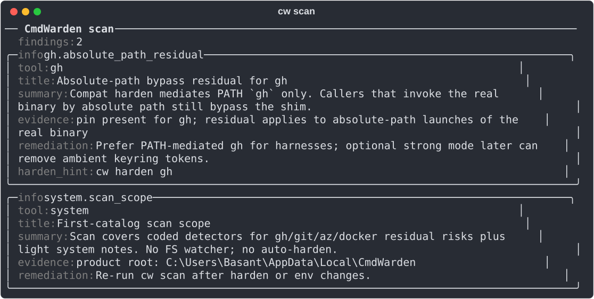
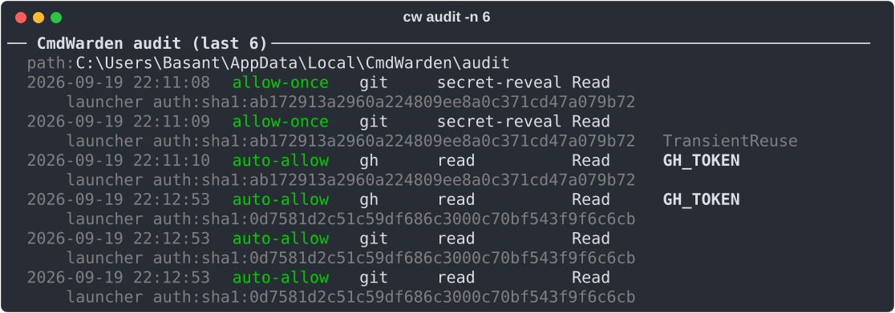

# Audit and scan when something feels wrong

**When:** A command was blocked, you are not sure the shim is active, or you suspect leftover env tokens.

```powershell
cw doctor
cw whoami
cw policy list
cw scan
cw audit
cw audit -n 20
```

`cw scan` lists residual risks with the command that fixes each one:



`cw audit` lists the newest gate decisions. `TransientReuse` means a repeated command reused your earlier click:



*Expect:* doctor = agent health; whoami = which launcher CmdWarden sees; scan = residual risks (e.g. ambient tokens, PATH issues, vault entries older than 90 days) without printing secrets; audit = recent allow/deny decisions (including Approval Gate Deny / Approve Once).

## Send gate decisions to the Windows Event Log

Security teams read the Windows Event Log, and a SIEM can collect it. Turn on a copy of each gate decision there:

```powershell
cw audit eventlog on
```

Windows asks for admin once, because an event source is for the whole PC. Then the Session Agent writes each gate decision to **Event Viewer > Windows Logs > Application**, source `CmdWarden`. No agent restart is necessary.

| Event id | Level | Decision |
|---|---|---|
| 1001 | Information | `auto-allow` |
| 1002 | Information | `allow-once` |
| 1003 | Information | `session-grant` |
| 1004 | Information | `session-allow` |
| 2001 | Warning | `deny` |
| 2002 | Warning | `unavailable` |
| 3001 | Warning | `redact` (leak guard) |

The event text has one `Label: value` line per field: tool, command class, policy level, secret name, reason code, launcher, and time. It never has a secret value.

The local audit trail stays the main record. A process that runs as you can delete that file, but it cannot clear the Application log without admin. `cw audit eventlog off` removes the source. Events already written stay in the log.

**In CmdWarden Vault:** **Doctor** = `cw doctor`, **Hardened Tools** = `cw harden --list`, **Detectors** = `cw scan`, **Secret Usage** = `cw audit`, **Secret Gates** = `cw policy list` + `cw policy sessions`. The Detectors page scans the app's own environment. Run `cw scan` in a terminal to check that terminal's variables.
